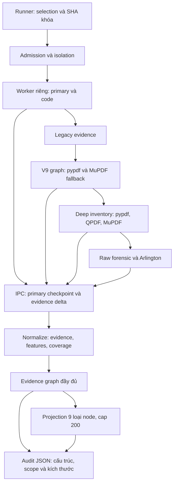

# Audit graph từ bundle trích xuất đã lưu

`scripts/lab/audit_graph_extraction.py` đọc JSON của một job đã kết thúc. Công cụ không nhận đường dẫn PDF, không gọi parser PDF, không sửa Extractor và không tạo job chạy thật.

## Đường chạy được đối chiếu



Fallback graph và native inventory là hai đường khác nhau. Có inventory QPDF không chứng minh đã xây được semantic graph QPDF. `backend_status`, `inventory_present`, `inventory_status` và `graph_status` được ghi riêng.

Parent giữ checkpoint và accumulator khi các lỗi worker được xử lý bên trong `profile_pdf`. Nhánh `except (OSError, ValueError)` bên ngoài profile trong orchestrator có thể gộp lỗi thành `worker_admission_failed`; mã này không đủ để xác định lỗi bắt đầu ở admission, IPC hay giai đoạn sau. Audit không đổi nhánh này.

## Input, integrity và output

Input gồm `job.json`, `selection.json`, `result.json`, các `private_bundles/NNNN.json` và index nguồn đã kiểm chứng từ lần xuất số liệu trước. Index phải giữ đúng thứ tự, SHA, nhãn, split và SHA của từng bundle.

- Kiểm tra job/result contract, selection hash và index trước khi tạo thư mục output.
- Chỉ đọc file thường, từ chối symlink và đọc quá trần. Bundle tối đa 8 MiB + 1 KiB; selection/index tối đa 4 MiB.
- Không ghi vào cây thư mục job đầu vào. Mỗi lần audit tạo `run_<UTC>_<job-prefix>` mới; không ghi đè lần trước.
- Giữ đủ mẫu số khi file thiếu, sai checksum hoặc sai schema. Bundle sai schema nhưng còn đọc được graph có thể giữ diagnostic, với `availability=invalid_schema` và `bundle_schema_valid=false`.
- Giới hạn cases ở 1 MiB/record và 64 MiB/tệp. Output không chứa evidence ID, nội dung tài liệu, script, đường dẫn nguồn hay exception text tự do.

Các artifact là `locked_methodology.json`, `cases.jsonl`, `metrics.json`, `audit_report.md` và manifest checksum. `progress.json` chỉ phục vụ theo dõi khi audit đang chạy. Bản hoàn tất được lưu mới dưới `reports/experiments/pdf_graph_audit/` trên DEV.

Agent chạy CLI trên release đã kiểm chứng tại LAB:

```bash
python scripts/lab/audit_graph_extraction.py --job-id <SHA256-job> --expected-index <index-JSON-da-kiem-chung>
```

Đây là đọc artifact lưu sẵn, không phải lệnh dành cho operator. Lần chẩn đoán tương lai có đọc PDF thật vẫn cần human gate `lab run`.

## Phân biệt bằng chứng và suy luận

`parser_object_candidates` bao gồm cả failed read. `parser_objects_with_projection` chỉ đếm record có projection dictionary; `parser_objects_observed` còn yêu cầu observation status observed. Không chuyển candidate thành node thành công.

Với projection hiện tại, audit đếm riêng node bị loại theo kind, status hoặc cap; edge bị loại do endpoint không được giữ; isolates; parallel edges và self-loop. Duplicate ID và dangling endpoint là lỗi cấu trúc. Cycle, shared reference, nhiều backend và parallel edges hợp lệ không bị tự động xóa hoặc gộp.

Phân loại chỉ dùng bằng chứng cấu trúc và worker; không dùng nhãn hoặc split để suy nguyên nhân. Các nhóm worker bị gộp, timeout, protocol/resource và parser lỗi chưa xác minh nguyên nhân gốc giữ `root_cause_status=unresolved`. Khi inventory có object observed nhưng bị loại khỏi projection, `projection_filter/confirmed` chỉ xác nhận cơ chế của view đang xuất; không chứng nhận PDF hoàn chỉnh hay định nghĩa một graph mô hình mới.

Không tự chứng nhận PDF hỏng, không thể tạo graph hoặc rỗng hợp lệ từ lỗi parser hay thiếu node. Mã nguyên nhân ngoài danh sách duyệt không được xuất ra Windows; nội dung gốc chỉ còn tại LAB và được gắn với hash nguồn.

## Hai phép đo kích thước

### Byte đối tượng gốc

`original_object_span_bytes` dùng interval nửa mở `[byte_start, byte_end)`, từ header đối tượng gián tiếp đến hết token `endobj`. Chỉ đo record `forensic_object_declaration` của `raw_forensic`, trạng thái observed, `source_space=original`, top-level đã xác minh, identity hợp lệ và locator khớp producer. Nếu producer lặp lại object number/generation thì chúng phải khớp record.

Các trường hợp không áp dụng, thuộc decoded object stream, thiếu ranh giới hoặc chưa đủ provenance giữ null và reason riêng. Không ghép backend/revision chỉ bằng object number; không áp span của physical object lên node ngữ nghĩa khác. Tổng các span có thể chồng nhau, không phải độ phủ PDF.

### Dung lượng JSON

`node_record_storage_bytes` đo từng record đã serialize. `graph_wire_storage_bytes` serialize toàn bộ `nodes` và `edges`; bản projected dùng đúng tập node/edge đã giữ. Quy tắc là JSON UTF-8, sort keys, compact separators, `ensure_ascii=false`, finite numbers và không newline.

Đây là dung lượng representation canonical, không phải byte đối tượng PDF, RAM, hoặc kích thước tệp gzip. `source_bundle_bytes` ghi riêng số byte tệp bundle thực tế. Không chọn phép đo storage làm predictor trong audit.

Phân phối có count/null_count, min, median, nearest-rank p95, max và total. Khi không có phép đo, min/median/p95/max là null. `feature_dim=null` vì không materialize tensor; 19 chỉ là chiều mục tiêu của builder cũ. Span đo được trong evidence đầy đủ không backfill thuộc tính `size_bytes` của projection mô hình.

## Kiểm thử

```powershell
.\.venv-windows-dev\Scripts\python.exe -m pytest tests/test_graph_audit.py tests/test_graph_audit_job.py -q
```

Kiểm thử dùng JSON kiểm soát, không dùng PDF sinh hoặc PDF không tin cậy: candidate/observed, cap/filter, multigraph/cycle, duplicate/dangling, provenance span, serialization, privacy, checksum và giữ nguyên input. Trạng thái full suite và kiểm thử tập trung được báo riêng; audit không tuyên bố sẵn sàng huấn luyện.
