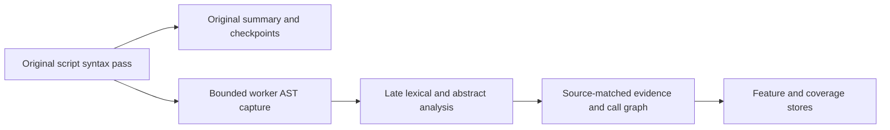

# Coverage-aware PDF extraction implementation

The [extract-pdf plan](../plans/extract-pdf/plan.md) is a six-stage research
roadmap. This implementation starts with its evidence/export foundation and
metadata-only offline-job preparation. It does **not** complete the 16-week
roadmap or establish improved detection on real PDFs.

The authorized scope on 2026-10-15 is source development, benign synthetic
tests, manifest/report inspection and preparation of a static CIC job. Real PDF
processing must wait for VMware-console isolation checks. Rendering, JS
emulation/evaluation, Reader execution and CAPE are outside this authorization.

## Implementation and remaining acceptance

| Plan stage | Implemented/reused now | Remaining acceptance/work |
| --- | --- | --- |
| 1: contracts, isolation, partial evidence | `malpdf.extraction` exports three versioned stores; existing v9 resource-limited disposable workers/checkpoints; explicit observation states and cross-store validation | The historic 21 partial PDFs have **not** been rerun; 21/21 acceptance remains unverified |
| 2: independent parsers, filters, recursion | Legacy v9, native inventories and independent byte grammar/xref/Prev/object-stream analysis; scoped differential merger; filters and recursive artifacts | Malformed/ambiguous boundaries and capped scopes stay incomplete; native media/archive formats beyond ZIP and real-PDF acceptance remain open |
| 3: graph, Arlington, semantics, visual | Original v9 graph/AST, raw IR, locked Arlington candidates, bounded lexical/scalar script analysis and lossless byte-raster tiles with source-linked offsets | Complete Arlington/reachability, interprocedural/heap/global-script semantics, media and page-render/OCR/QR acceptance remain open; rendering requires separate approval |
| 4: event planning and dynamic tiers | Bounded inert document/page/annotation/field action plans, name-tree/XFA declarations and raw bookmark/link/field candidates; source paths and cycles/caps remain visible | XFA DOM selectors, full event/Reader feasibility and real-PDF coverage remain unverified; JS emulator, Reader/CAPE and reingestion require the separately approved environment |
| 5: locked evaluation | Metadata-only job reuses saved seed42 CIC Train/Validation selection, checks labels/related/file/feature-group partition integrity, keeps failures in denominators, records status/median/P99/RSS | No new PDF/classifier evaluation; no recall/FPR/coverage improvement claim; independent labeled threat-family and evasion studies need separate locked designs |
| 6: packaging and community release | Library API, `malpdf extract`/`export`, offline CLI, JSON Schemas, typed tables/graphs and explicit static parser/decoder/feature SDK | Containment container/Compose release, native PyG/DGL integration and community/corpus benchmarks remain open |

## Three-store contract

`extract_pdf()` returns a `pdf-extraction-v1` bundle with:

- `evidence_store`: backend-local evidence identities, object number/generation,
  nullable offsets/revisions, original v9 details, edges, capability checks and
  unresolved conflicts. MuPDF views retain `is_synthetic_repaired=true`.
- `feature_store`: numeric/boolean/null values, one of the nine observation
  statuses, source scope, completion flag, limitations and resolvable evidence
  references. A zero is checked absence only within the stated complete scope.
- `coverage_report`: all 14 planned groups, actual backend states, missing
  capabilities, versions, seeds, worker limits/cleanup/timing/RSS and reasons.
  `whole_document_complete` is always false in this foundation release.

The independent `trigger_plan` contains inert event descriptions and
`execution_status=not_run`. It does not launch programs or follow URLs.
The [event-plan contract](trigger_plans.md) describes source ownership, nullable
navigation targets, XFA limitations and the shared metadata traversal budget.
The planner reads existing exported graph/raw IR only, after the worker; it
does not parse or decode additional bytes or change primary measurements.

`malpdf.extraction.schemas.schemas()` returns JSON Schema 2020-12 documents
for the three stores without accessing a PDF. `validate_bundle()` is an explicit
Python contract validator, with additional cross-store/reference/absence
invariants; it is not a general JSON Schema interpreter.
The development suite separately checks the published schemas and instances
with the declared `jsonschema==4.26.0` Draft202012Validator, using an offline
registry that refuses external reference retrieval.

The primary legacy vector is preserved verbatim in `primary_checkpoint`,
including nulls and `-1` sentinels. Exported `canonical_*` records describe a
sentinel as unknown (`value=null`, `partial`) while retaining the original value
in that checkpoint. A raw/primary mismatch stays partial with a conflict reason.
No preprocessing, model, compatibility gate, calibration or threshold changes.

Unknown offsets and revisions stay null. `filter_chain=null` means the filter
sequence was not captured; `[]` on a `stream_decode` record means the checked
dictionary has no filters. Legacy v9 nodes retain their original representation.
The additive stream view records per-filter metadata and retains bounded blobs
when requested by the caller. It does not cover all streams, historical revisions
or orphan objects. The original files remain at their private source paths.
The legacy/native stream views keep original declared `/Length` comparison as
`not_run`; parsed dictionaries do not prove authored length. The separate raw
view checks direct length tokens and safely resolved references at their exact
byte locations. No missing measurement becomes zero.

## Schema conformance and runtime invariants

Coverage backend schemas declare the metadata actually emitted by the native,
Arlington, script and byte-image adapters. Required fields remain
`observation_status` and `limitations`; optional typed fields are `scope`,
`version` (object/string/null), `model` (object), `graph_observation_status`,
`graph_limitations` and `lexical_observation_status`. Unknown core fields are
rejected by both the schema and runtime validator. Versioned core stores,
observation/feature records and coverage groups remain closed shapes; original
edge attributes, details, capability/conflict objects, worker/provenance and
the bundle's extra envelope metadata remain opaque extension points. Nothing
is discarded to make validation succeed.

The runtime also checks group and global status counts against actual features,
known observation states, string-list limitations, scopes, nullable versions,
store identities, reference resolution, ID uniqueness and locator ordering.
Explicit zero status counts are allowed, but do not prove whole-format absence.
`whole_document_complete` must be exactly false in this foundation v1 protocol.
Opaque metadata must still serialize as JSON: non-string mapping keys, nonfinite
numbers, unsupported objects and cycles fail rather than being coerced or erased.
Validation never edits a caller's bundle or recomputes model measurements.

JSON Schema validates JSON structure and cannot replace these data-dependent
cross-store checks. It also treats1.0 as a mathematical integer; Python runtime
locator/count fields deliberately require actual ints for typed exports. See
the [Draft 2020-12 numeric rules](https://json-schema.org/draft/2020-12/json-schema-validation)
and [validator documentation](https://python-jsonschema.readthedocs.io/en/stable/validate/).
The [offline registry](https://python-jsonschema.readthedocs.io/en/stable/referencing/)
is exercised with network functions blocked and rejects an unregistered remote
reference. Schema generation itself uses only the standard library and returns
independent JSON trees; it neither fetches a metaschema nor accesses samples.

`tests/test_extraction_contracts.py` is an independent Draft 2020-12 oracle for
positive/negative structural cases plus runtime-only semantic invariants. Saved
benign root/nested-PDF/XFA bundles are separately checked as12 store instances;
their source bytes remain unchanged. The dev validator is installed solely from
`pyproject.toml`'s `[dev]` extra, not imported by production extraction.

## Existing-bundle tabular and graph exports

`malpdf export bundle.json [other_bundle.json ...]` and the library functions
`export_bundles`/`export_bundle_files` produce JSONL, Parquet and graph data from
explicit existing bundles. They do not read a PDF, follow raw-artifact paths,
load a classifier or select a dataset partition. All inputs, including timeouts,
unavailable document identities and repeated sample hashes, remain separate
occurrences. Nothing is deduplicated, filled, normalized or fitted.

Each invocation creates a unique `run_<UTC>_<commit>/` directory below ignored
`data/processed/`, refusing collisions and symlink ancestors. `export_manifest.json`
records expected/completed input counts, input hashes, per-file checksums/status,
effective Python/package versions, exporter source hashes, Git/worktree state
and caps. Its states are `running`, `completed`, `failed` or `interrupted`.
Invalid inputs stop the batch with the failed input index and completed-prefix
evidence retained; they never become a successful export with dropped rows.
A hard interruption can leave `running` and unfinished files, which do not prove
completion. The utility does not modify source bundles or older runs.

The six `pdf-tabular-v1` tables are stored separately by format:
`jsonl/<table>/bundle_<index>.jsonl` and
`parquet/<table>/bundle_<index>.parquet`. Each table directory is a homogeneous
dataset, including correctly typed empty files. Fixed Arrow schemas and their
nullability are exported in `table_schemas.json` and embedded in Parquet metadata.
List child fields explicitly use the Parquet-compliant name `element`, preserving
strict Arrow field metadata after a read as well as logical list types.

| Table | Data retained |
| --- | --- |
| `documents` | Bundle hash/status/profile; original envelope, coverage report and non-row store metadata as JSON, including trigger plans, capabilities/conflicts and unknown extensions |
| `features` | Original feature JSON, group/status/scope/completion, evidence refs, limitations and nullable typed value projections |
| `evidence` | Original record JSON, evidence ID/backend/kind/status, nullable object/generation/revision/offsets, filter-chain distinction and repaired provenance |
| `edges` | Original edge JSON/ID, source/target IDs and contiguous int64 source/target indices |
| `coverage_groups` | Every group/status/count/scope/limitation with original entry JSON |
| `backends` | Every backend/status/limitation with original entry JSON, preserving versions, model pins and adapter extensions |

Join on `(export_id, bundle_id)` and then evidence/feature IDs within that
occurrence. `sample_sha256` can be null or repeated and is not a row key.
`record_index` preserves array order; coverage/backend mappings are sorted by
key so ordinary JSON object key order does not change their indices.

Feature values use `value_type` plus separate nullable `value_boolean`,
`value_int64`, `value_float64` and exact `value_json`. False,0,-0.0 and unknown
remain distinct. An integer outside int64 has `integer_overflow=true` and its
exact value in JSON, with the int64 projection null. Oversized locators similarly
list `locator_overflows`; original JSON retains every digit. This projection
null does not assert that the source value was unknown. No pandas dtype inference
or all-null-column inference is used. `restore_bundle(tables)` restores one
occurrence from JSONL/Parquet row lists, validates the bundle and rejects any
inconsistent typed projection, including tampered references/indices. JSON
semantics and original arrays/values are preserved; Python container classes
and JSON object insertion order are not part of the format.

Graphs use the [NetworkX node-link format](https://networkx.org/documentation/stable/reference/readwrite/generated/networkx.readwrite.json_graph.node_link_data.html),
with `directed=true`, `multigraph=true` and an explicit `edges` key. Full records
are nested under `record` to avoid collisions with reserved `id/source/target/key`
attributes. Parallel edges, self loops, isolated nodes, uncertainty and repaired
flags survive. Decode with `nx.node_link_graph(data, edges="edges")`; node indices
match the evidence table's `record_index`. Feature attribution remains in the
feature table and is not converted into invented node features or labels.

`graph_tensors(bundle)` optionally returns an int64 COO `edge_index` with shape
`[2,E]`, explicit `num_nodes` including isolates, original IDs/records and graph
metadata. The schema follows the documented [PyG data convention](https://pytorch-geometric.readthedocs.io/en/latest/get_started/introduction.html)
and [DGL graph constructor](https://www.dgl.ai/dgl_docs/generated/dgl.graph.html):

```python
from malpdf.extraction.graph_exports import graph_tensors
view = graph_tensors(bundle)
# With separately installed frameworks, if a downstream study requires them:
# pyg = Data(edge_index=view["edge_index"], num_nodes=view["num_nodes"])
# dgl_graph = dgl.graph(tuple(view["edge_index"]), num_nodes=view["num_nodes"])
```

Only NetworkX round trips and the actual PyTorch tensor layout are tested here;
PyG/DGL are not installed or invoked by this exporter. No pickle/model/tensor
binary is written. Parquet uses the declared PyArrow stack with explicit schema,
version2.6, no compression/dictionary/statistics and1024-row groups, following
[the Arrow writer API](https://arrow.apache.org/docs/19.0/python/generated/pyarrow.parquet.write_table.html).

Default limits are256 explicit inputs,64MiB canonical/source JSON per bundle,
512MiB total charged input,200000 rows per bundle/2000000 total, JSON depth128/
1000000 entries per bundle and2GiB data output plus a bounded2MiB control manifest.
Files are loaded sequentially and each bundle's table files are closed before
the completed-input checkpoint. Duplicate JSON keys, NaN/Infinity, malformed
contracts, oversized structures and unsupported formats fail explicitly without
truncating records. Bounds apply to this metadata exporter; original parser and
shared PNG/raw retention budgets are unchanged. This is a local data export,
not an upload or a new extraction/evaluation experiment.

## Feature catalogue for this increment

| Record prefix | Measurement and scope |
| --- | --- |
| `raw_byte_000_count` through `raw_byte_255_count` | Counts across every byte in the verified snapshot |
| `raw_size_bytes`, `raw_entropy` | Exact byte length and Shannon entropy in bits/byte |
| `raw_header_offset`, `raw_last_eof_offset`, `raw_prefix_*`, `raw_suffix_*` | Lexical marker positions and bytes/entropy before the first `%PDF-` and after the final `%%EOF`; missing markers produce nulls |
| `raw_escaped_name_candidates` | Observed lexical name hints with `#xx`; partial when the bounded candidate scan stops |
| `lexical_*` | Existing exact PDFMalExtract token-count conventions; strings/comments/streams may contain these bytes |
| `canonical_*` | Unmodified primary model measurements projected with explicit missingness and scope |
| `legacy_*` | Existing v9 per-column provenance ledger over saved primary measurements; no refitting or invented values |
| `v9:<id>:ast:*` | AST node count/depth, loop count and computed-member count for one successfully parsed script; syntactic evidence only |
| `script_semantic_call_sites`, `script_semantic_api_candidates`, `script_semantic_unknown_calls` | Counts/lower bounds in source-matched captured ASTs; excluded/unvisited/candidate calls remain distinct; no runtime or exploit detection claim |
| `script-semantics:<document>:<script>:bindings/finite_facts/unknown_facts` | Per-script lexical binding and abstract fact counts, with source evidence and decoded-script ranges; no model-input changes |
| `observed_graph_nodes_<backend>`, `observed_parser_conflicts` | Counts/lower bounds in the visited v9 graph; no proof of whole-file absence or parser agreement |
| `stream:<id>:decoded_bytes` | Full decoded size for one stream only after every declared filter succeeds; null for failure/unsupported/encrypted/capped results |
| `stream:<id>:filter:<index>:output_bytes` | Size of a completed filter output or an explicitly partial prefix; failure prefixes never become input to the next filter |
| `observed_stream_status_*` | Counts/lower bounds in the stream supplement, retaining error/unsupported/encrypted/resource cases in the denominator |
| `artifact:<id>:size_bytes`, `observed_artifact_kind_*` | Complete candidate byte sizes and observed occurrence counts; no validity, activation or maliciousness inference |
| `child:<sha256>:*` | Separate measurements for a unique nested PDF's immutable bytes; root model measurements are preserved |
| `inventory_object_candidates_<backend>`, `inventory_object_status_*` | Native xref candidates and observed/error/resource counts, including failed reads; each backend has its own scope |
| `inventory_comparison_*` | Scoped counts of projection equality, value/generation disagreements and unavailable/one-sided views; no file/revision identity or whole-format absence claim |
| `forensic_observed_*`, `forensic_membership_*` | Observed byte/decoded declarations, syntax nodes, xref contexts and scoped membership counts; failures and unknown scopes remain in evidence |
| `forensic-object:<id>:declared_endpoint_matches` | Verification of a terminator at the direct/resolved authored length endpoint; null when the length/context cannot be established |
| `byte-source:<id>:tile:<index>:valid_pixels/padding_pixels/byte_entropy` | Exact source-byte count, explicit padding and entropy over valid bytes in one admitted raw-byte tile; entropy stays null when the pixel-work cap prevents encoding |
| `byte-source:<id>:source_size_bytes/encoded_source_bytes/worker_retained_source_bytes/persisted_source_bytes` | Per-view mapping and retention counters; overlapping object/stream views cannot be summed into original-file coverage |
| `byte_image_file_encoded_ratio`, `byte_image_file_persisted_ratio` | Fraction of original file bytes encoded/persisted as whole tiles; unavailable bytes and padding do not count |

Layout evidence also keeps a 256-value histogram, at most 256 marker offsets per
marker, 256 non-overlapping 4 KiB entropy windows and 4096 lexical name candidates.
Truncated lists explicitly report incomplete enumeration. Escaped-name hints
retain offsets and raw/normalized digests without exporting arbitrary names.
No hidden-payload identity or exploit coverage is inferred from these hints.

## Additive stream decoding

`deep-static` observes stream objects already discovered by the v9 graph, then
runs the new filter matrix **after** v9 completes. Existing primary/v8/v9
measurements and their budgets are not replaced or starved by this new pass.
The supplement receives only v9's recorded remaining decoded-byte allowance.

The supported general filters are Flate, LZW (`EarlyChange=0/1`), ASCIIHex,
ASCII85 and RunLength, including their PDF aliases. Flate/LZW support TIFF
horizontal differencing for 1/2/4/8/16-bit samples and all five PNG predictor
types with correct color/pixel stride. PNG reconstruction follows the
[W3C filter algorithms](https://www.w3.org/TR/PNG-Filters.html); tests include
packed samples, 16-bit endianness and independent LZW width-transition vectors.
No source code is evaluated by a decoder.

`/Crypt` remains `encrypted` without a decryption context. Explicit
`/Name /Identity` passes bytes without decrypting. CCITT, JBIG2, JPX, DCT and
unknown codecs remain `unsupported`; there is no native image decoding or
rendering in this increment. Unsupported/unknown parameters and invalid filter
alignment remain explicit failures. Their decoded sizes/hashes stay null.
Unresolvable filter/parameter references remain `partial` with a fixed reason
code; no decode is attempted and a closed/missing backend view does not prove
malformed compressed bytes.

Each completed or failed layer records input/output identities, parameter
projection, byte debit, status and retention metadata. Strict Flate errors keep
the observed prefix, including checksum/truncation failures. Its digest verifies
the retained bytes' identity, not successful decompression integrity. Later
filters are `not_run`. A genuinely empty decoded stream is `observed`, with a
verified empty digest and size0, even when the remaining byte allowance is zero.
Each completed layer emits an independent checkpoint. If a subsequent filter
times out, the active-stream checkpoint still exports the completed layer and
its source relationship; it does not label the unfinished whole stream decoded.

Limits within the existing worker are: 128 discovered streams (or the smaller
configured object cap), eight filters, 1 MiB output per layer (or the smaller
configured decoded-byte cap), expansion ratio100, the remaining shared decoded
budget, and 512 KiB stream metadata with reserved terminal space. Predictor
inputs are counted in the decode debit and retained when used. Metadata/depth/
source limits preserve earlier entries and explicitly report incomplete scope.
Parameter-reference reads share one configured object-count allowance across
all streams; the allowance is not reset for every stream. Metadata reserves room
for an active stream and terminal reasons. Oversized filter sequences retain a
bounded prefix/count and fail before decoding.
Wall/CPU/RAM limits remain those of the original worker; no additional time or
memory budget is granted.

The existing parent-held v9 transport retains raw, intermediate and partial
bytes as non-executable digest-named `.bin` files, capped at 10 MiB **shared**
with v9 for each sample. It verifies size and digest; the parser still cannot
write files (`RLIMIT_FSIZE=0`). The official offline job requests persistence in
`data/processed/pdf_extraction/<run>/sample_<index>_streams/`. Direct library
callers may pass `raw_artifact_dir`; `malpdf extract --raw-artifact-dir` enables
persistence to a fresh ignored directory under `data/processed/` or `artifacts/`
for `deep-static`. Without it, the convenience CLI validates transported blobs
in memory. These directories also contain generated byte-raster PNG blobs.
Read `parent_verification_status`:
`verified` means persisted; `verified_not_persisted` means checked transport
only; unavailable or interrupted storage remains explicit. Do not infer blob
existence from the worker's transmission claim alone.

## Lossless byte images with source offsets

After the prior primary/native/raw/Arlington/script checkpoints, `deep-static`
maps admitted bytes to grayscale PNG tiles: one byte becomes one 8-bit sample,
in row-major order, without resizing, normalization or a fitted transform.
This is a byte view and does not render PDF pages or decode embedded images,
fonts or media. Existing float32 Markov probabilities and model inputs stay
unchanged. The encoder uses Python `struct`/`zlib`, with PNG signature, IHDR,
IDAT, IEND, CRC32, filter0 and no interlace or metadata chunks, following the
[W3C PNG format](https://www.w3.org/TR/png-3/). Requested/effective geometry,
algorithm version and zlib compile/runtime versions are recorded and job-locked.

Default tiles are 256 columns by at most256 rows. A final short tile has only
the required rows; zero padding in the last row is explicitly masked by
`valid_pixels`. Source bytes occupy the row-major prefix `[0, valid_pixels)`.
For pixel `(x,y)`, `pixel_offset(tile,x,y)` returns
`tile.source_byte_start + y * tile.width + x` in the declared source namespace,
or null for padding. Coordinates are validated. `pixels_sha256` includes padding;
`valid_bytes_sha256` and entropy cover source bytes only. Empty sources create
no fake PNG and a zero-length scoped mapping, rather than a synthetic zero image.

Source views include the root file, confirmed original-byte raw object spans,
decoded ObjStm members, completed decoded streams and admitted recursive artifacts.
A declaration with an unverified stream boundary can expose only its verified
object-value prefix, marked `source_span_complete=false`. Xref candidates without
confirmed physical origin remain unavailable. Original-byte views retain exact
file ranges and known object/generation; decoded views retain a container digest
and decoded-relative range, with original-file offsets null. Child PDFs retain
their own document digest. MuPDF/repaired provenance is inherited. Child raw
forensic objects and newly discovered inventory-only streams are not yet routed
into this pass. Every exported source/tile has a resolvable evidence edge;
unmatched sources are counted without inventing evidence.

Sources are admitted in stable root/object/stream/artifact order. Tiles alternate
head/tail chunks within each source and are attempted round robin across admitted
sources. Omitted ranges remain unobserved; coverage is not inferred from selected
tiles. Limits are128 sources,256 tile attempts,4MiB mapped pixels including
padding,4MiB unique retained PNG bytes,10MiB/256 cached source blobs, and512KiB
metadata with terminal reserve. All are bounded by the original worker's CPU,
wall and memory caps. Decoded sources reuse bytes already admitted to the shared
raw transport; this pass performs no additional PDF read, parse or decode.
Generated PNGs consume the same existing10MiB retention allowance as raw/decoded
evidence, with content-addressed deduplication and no allowance reset. Every tile
attempt is charged to the pixel-work budget, including duplicate views.

PNG artifacts use their digest plus `.bin` and MIME `image/png`. Worker retention,
parent verification and persistence are separate: exported `image_availability`
is `persisted`, `verified_not_persisted` or `unavailable`. A hash or successful
transport alone is not proof of a file on disk. Source views can overlap;
only the root-file ratios describe coverage of original file bytes. Earlier
checkpoints survive later byte/metadata caps or worker interruption, which marks
counters as lower bounds. Whole-document coverage and the byte-raster backend
remain partial even when all admitted spans map successfully. Generated benign
tests independently decode these PNGs with the already installed Pillow stack
and compare every valid byte and offset; no real PDF has been checked here.

## Bounded recursive artifacts

After the root filter matrix, `RecursiveCarver` consumes only **complete**, hash-
verified decoded bodies. Magic and verified JS/XFA/ObjStm/image declarations
route candidates; unknown unforced streams remain bounded unclassified inputs.
Media signatures are recognized candidates with `unsupported` analysis, not
decoder or exploit coverage. Partial filter prefixes are retained but never
recursed into. There is no arbitrary offset carving or automatic payload launch.

Each occurrence records its source evidence, container, slot, depth, ancestors,
exact byte digest and retention. Identical `(sha256, kind)` content reuses one
analysis while every lineage survives. An ancestor digest blocks recursion.
Children inherit synthetic-repair provenance. Child PDFs use the same canonical
analyzer on an in-memory snapshot and the same v9/stream machinery, inside the
original worker. Their evidence IDs retain their own document digest, features
are prefixed `child:<sha256>:`, and coverage remains per document. Child actions
do not seed the root trigger plan. No child inherits a dataset/class label;
any future study needs its own lineage/duplicate audit and locked design.

ZIP supports stored and raw-DEFLATE members after bounded central-directory and
local-header checks, declared-size/CRC verification, and data-descriptor checks.
The binary layout follows the [PKWARE specification](https://pkware.cachefly.net/webdocs/casestudies/APPNOTE.TXT).
The standard library supplies bounded directory metadata only: no archive
`open/read/extract` API, external unpacker or output filename is used. Names are
hashed metadata; unsafe paths and symlinks are recorded without following them.
Encrypted members, ZIP64, multidisk, other compression and unsupported layouts
stay explicit. Damaged/overlapping/capped members keep prefix evidence and are
not admitted as complete artifacts. `.js`/`.xml` suffixes are candidate hints,
never proof of PDF activation. JS is parsed as syntax only; XML forbids DTDs,
entities and external resources. ObjStm members retain bounded syntax projections
and generation0 with decoded-relative offsets; references stay opaque, and no
execution graph or original-file byte offset is inferred.

Defaults are depth4, 64 occurrences, 1MiB per artifact, 4MiB cumulative admitted
queue bytes, 64 ZIP members, expansion ratio100, eight PDF children, 128 child
streams and 1MiB recursive metadata with terminal reserve. Metadata overflow
keeps the last bounded snapshot and an omitted-record lower bound; counters in
that interrupted snapshot must not be used to resume work. Each parser pass
reserves up to256 from one shared object allowance derived from `max_objects`;
this is a traversal quota per pass, **not** measured total native parser objects.
XML nodes, script count and AST-node allowances include prior root work. Completed
exact script identities may reuse validated ASTs without additional parsing.
Child explicit decodes debit the remainder after root v9 and filters. Uncertain
child accounting burns the remaining decode/AST/script allowance. Internal native
xref/text/parser decoding remains covered by OS caps, not an exact decoded-byte
ledger. No extra worker, CPU/wall/RAM/retention allowance is granted.

Completed artifact/member/XML/object checkpoints survive later limits or worker
timeouts; incomplete siblings remain unavailable. These are synthetic-fixture
guarantees so far. Full format validity, embedded-file enumeration, PDF revision
history, media steganography and labeled threat coverage remain unverified.

## Independent native object inventories

After the original v9/filter/carver checkpoints, `deep-static` runs a separate
bounded inventory of QPDF, MuPDF and pypdf on the same immutable byte snapshot.
All three are attempted even when the primary profile succeeded. No repaired
PDF is saved or fed between engines, and these inventories do not replace the
primary model vector, v8/v9 graph, or their budgets. Errors are retained as
per-object/per-backend observations. Time/RAM remain the original worker's caps.

The declared `pikepdf==10.17.0` supplies QPDF. Its
[document/object APIs](https://pikepdf.readthedocs.io/en/latest/api/main.html)
are used with recovery and inherited-page-attribute rewriting disabled, explicit
scalar conversion and suppressed/redacted warnings. Native QPDF objects are
converted into inert common projection containers without reparsing their text;
real numbers retain their native Decimal precision. The adapter reads raw
streams only, never decoded-stream or whole-PDF syntax-check APIs. Native
xref/object-stream decompression remains OS-capped rather than part of the
explicit filter debit. The QPDF library version is recorded separately from
pikepdf, including in prepared-job fingerprints.

QPDF exports exact object/generation selections, compressed-object container/
index metadata and offsets only after matching the original byte header to the
same pair. Offsets for compressed objects remain null. pypdf inventories its
exposed xref map, including retained generations; these are not automatically
proved active or assigned a historical revision. MuPDF's public xref inventory
is number-addressed, so its generation and file offsets remain null. Its native
object selection/raw streams are independent, while the existing adapter parses
its canonical object text using pypdf syntax. This shared syntax dependency is a
limit on full parser independence. MuPDF views preserve synthetic provenance.
Warning counts/categories stay explicit without messages.

Projection hashes cover bounded dictionary/array/scalar/reference values; names
and strings stay hashed. Up to 64 root key/value hashes localize disagreements.
Numbers use canonical decimal tuples, and `/Length` is excluded from stream
comparison because parser dictionaries do not prove authored lengths. Failed
or truncated projections and unavailable raw stream bytes are never compared as
verified empty/absent values. Every compared record retains its own evidence ID.

The merger first matches known generations, then permits an explicitly uncertain
number-only candidate comparison when both sides are unambiguous. It preserves
value/key/raw-stream and generation-selection conflicts without choosing a
winner. Projection equality does not prove file, object or revision identity.
Missing objects in a partial/failed enumeration are `not_observed_in_partial_view`;
a complete inventory means only the stated engine-exposed scope. Existing graph
backend flags remain under `graph_observation_status`/`graph_limitations` when
the coverage entry reports the new inventory's status.

Caps are `max_objects` candidates per native view, a shared `max_file_bytes` raw
read allowance across the inventories, 1024 projection nodes/depth8 per object,
64 root key details, 2048 comparisons and 1MiB combined metadata with terminal
reserve. Blob retention shares the existing parent cap. Completed inventories
and localized comparison checkpoints survive a later overflow or worker timeout.
Candidate/status/comparison counts remain partial and keep failures in scope.
JS AST time for newly carved scripts is measured separately and is preserved
when the root itself had no scripts.

The original lexical profiler remains unchanged. The additional raw grammar and
xref/history scope is below. New inventory-only objects are not yet routed
through the v9 action/filter/carver passes; nested PDFs retain their prior v9
path. These scopes remain explicit in the acceptance inventory.

## Original-byte grammar, xrefs and static reference IR

`raw_syntax.py` implements a bounded lexer/object grammar from immutable bytes:
whitespace/comments, names with `#xx`, literal strings with nesting/escapes/octal/
line continuation, hex strings, exact decimal numbers, booleans, literal nulls,
arrays, dictionaries and indirect references. It calls no native PDF reader or
object parser. The existing PDFDocEncoding/BOM codec is reused only for string
projection identity. Raw token ranges/digests remain independent of that codec.
Duplicate keys remain ordered separate nodes; no first/last-wins normalization
is applied. Invalid escapes, NUL names, depth/token/string/node limits and
unfinished values stay explicit. Header and completed-value checkpoints survive
a later parse failure or worker timeout.

`raw_forensic.py` records every admitted physical declaration separately by byte
offset, including repeated object/generation pairs. It skips opaque stream data
only after the declared endpoint is verified. `/Length` references are resolved
only through a complete examined xref chain and only when every applicable
context agrees on the same scalar length. Ambiguous/unavailable boundaries stop
sequential scanning. Xref-targeted bodies may still be kept as candidates with
unverified context; a header inside known stream bytes is never promoted to a
top-level declaration. Raw/decoded/intermediate retention shares the parent cap.

Traditional xref subsections, trailer dictionaries, `/Prev` and hybrid `/XRefStm`
links are preserved. Xref streams validate `/W`, `/Index`, big-endian fields,
default widths, free/ordinary/compressed entries and original header identities.
Supplemental entries take precedence in the checked hybrid interpretation;
an unexpected supplement `/Prev` remains an explicit policy limitation. The
[QPDF stream-format reference](https://qpdf.readthedocs.io/en/stable/object-streams.html)
describes these representations. Cycles, conflicting entries and unresolved
targets stay partial without falling back to a more convenient revision.

Only structural XRef/ObjStm streams are decoded in this pass, using the existing
filter matrix and the **remaining** root/carver decoded-byte allowance. Earlier
interrupted metadata counters cannot resume decoding; an uncertain allowance
becomes zero. Failed prefixes are retained and never parsed as complete objects.
Object-stream members use this same independent grammar, generation0, container/
index provenance and decoded-relative locations; original byte offsets remain
null. Encrypted object streams/string interpretations are unavailable; no
password or decryption path is added. Decode time is recorded separately.

Every dictionary key/value and array item admitted within the caps has a syntax
evidence ID and static graph edge. Names/strings/values are redacted to fixed
vocabulary or hashes, with original ranges or decoded-container lineage.
References resolve independently under each examined xref context. Missing
targets receive separate `is_synthetic=true` nodes; actual `null` syntax and the
original reference remain untouched. `unlisted_in_examined_xrefs` is a scoped
membership observation, not a maliciousness or catalog-unreachability label.

Xref chain distance is not a revision number. Ordinals are assigned only after
the linked contexts have distinct top-level startxref/EOF pairs in chronological
order and their selected bodies/xref dependencies fit inside each corresponding
prefix. Otherwise the public revision locator is null. Linearized sections and
old xrefs pointing beyond their own footer do not prove historical identity.
The raw selected view is compared conservatively with native inventories; all
disagreements and generation/revision uncertainty remain unresolved.

Defaults derived from the worker are 2000 declarations, 128000 lexical tokens/
nodes,8192 exported IR nodes,16000 xref/reference entries,32 xref-chain contexts,
64 structural streams,2048 comparisons and1.5MiB metadata with terminal reserve.
Depth/string caps and wall/CPU/RAM are inherited. Limits preserve the last
bounded snapshot and mark counters as interrupted lower bounds, never resumable
allowances. Footer/ordinal proof covers only the examined linked contexts.
Arlington conformance, signature validation, arbitrary malformed-stream recovery,
full catalog reachability, media/steganography and real-PDF acceptance remain open.

## Locked Arlington catalog and static rules

The user authorized the public reference snapshot from
`https://github.com/pdf-association/arlington-pdf-model` at short revision
`b7d880b`, resolved by Git to
`b7d880b7a3d3c8f505c025f17763397475e90503`. The local ignored checkout is
`third_party/arlington-pdf-model/`, and the loader reads `tsv/latest` there.
`configs/arlington.lock.json` records that exact full revision, source, paths,
SHA256/size/Git blob identity for all **610 TSV files** and LICENSE/NOTICE.txt.
The catalog loads **3976 rule rows**. Two upstream DocInfo rows omit the final
optional `Note` cell; this is recorded as a loader note without editing TSV bytes.
The lock covers 497394 bytes, including licenses. It does not follow HEAD.

On a fresh dependency-preparation machine, acquire this explicitly approved
reference with the following commands. The project never downloads it during
loading or extraction. Preserve the checkout for Git identity checks and copy
the verified dependency into the offline LAB before processing real samples.

```bash
git clone --filter=blob:none --no-checkout https://github.com/pdf-association/arlington-pdf-model.git third_party/arlington-pdf-model
git -C third_party/arlington-pdf-model sparse-checkout init --no-cone
git -C third_party/arlington-pdf-model sparse-checkout set --no-cone '/tsv/latest/' '/LICENSE' '/NOTICE.txt' '/INTERNAL_GRAMMAR.md' '/MODEL_NOTES.md'
git -C third_party/arlington-pdf-model checkout --detach b7d880b7a3d3c8f505c025f17763397475e90503
.venv/bin/python scripts/23_arlington_model.py verify
.venv/bin/python scripts/23_arlington_model.py smoke
```

`verify` checks every local file against both the committed lock and the pinned
Git tree; missing, extra, changed, symlinked, malformed or differently checked-out
models raise `ModelUnavailable`. A manually updated checksum cannot disguise a
file from a different Git tree. There is no fixture or network fallback.
`smoke` also generates four benign static fixtures (blank page, wrong catalog
type, direct Pages and unknown key), uses the actual locked catalog in disposable
workers, and retains partial/final evidence in unique maintenance runs. Neither
command reads datasets. Unit tests use synthetic TSV/Git fixtures exclusively;
the separate smoke report proves real-reference integration, not real-PDF coverage.

`arlington_expression.py` parses expressions into a bounded inert AST, without
Python/JS eval. It implements typed literals, arithmetic with exact finite
results, comparisons, three-valued AND/OR/NOT, basic presence/length/rectangle
predicates and version conditionals. Unsupported functions, paths, extensions,
operands and resource cases yield `Unknown`, which cannot be coerced to bool.
Nested Boolean reduction of inapplicable version-conditioned values also stays
unknown when its semantics are not implemented; it never becomes a false violation.
The interpreter never reads files or executes PDF scripts. Large numeric
operands and nonterminating division remain unknown rather than rounded.

`arlington_validate.py` reads only private raw trees and cached xref-selected
objects after the raw forensic checkpoint. It cannot parse/decode additional
PDF bytes. Rules cover required/present fields, type alternatives, version,
direct/indirect representation, possible values, supported special cases and
disjunctive schema links. `IndirectReference=FALSE` allows both representations;
`fn:MustBeDirect` is a separate constraint. Dictionary null is absent unless an
explicit null type applies; array null remains a value. Inherited values link
their actual source, and defaults are separate virtual observations. Neither
changes original nulls, references, bytes, primary features or model inputs.

Checks identify the model table/line/file checksum and original IR source IDs.
Unknown keys and dictionary wildcard keys retain hashed identity and source
nodes, with no plaintext content added. Repeating array groups preserve missing
required group members. Link alternatives are OR candidates; a failing candidate
does not alone prove a document violation. Schema/reference/inheritance cycles,
encrypted strings, specialized text/date/tree semantics, extension context,
unsupported predicates and incomplete raw scopes remain indeterminate. No
`valid_pdf` or whole-document conformance claim is produced. Deprecated values
get a notice rather than automatic rejection. Candidate pass/fail/indeterminate
counts are partial evidence counts, not classifier metrics or percentages of
all 3976 rules covered.

Defaults cap the rule pass at 256 bindings, 2048 checks, depth24, 50000 expression
steps and512KiB metadata. Expression parsing caps text16KiB, tokens2048, AST
nodes1024 and depth32. Existing worker CPU/RAM/wall deadlines remain shared;
rule checkpoints are separate so interruption preserves primary and raw evidence.
The expression budget stops the pass when exhausted and keeps completed checks.
`complete=true` means that this bounded candidate traversal finished, while its
observation status stays `partial` and whole-PDF conformance remains unverified.

`configs/extraction_profiles.yaml` explicitly enables the lock. Job preparation
and checking verify the catalog and seal its provenance/file hashes with the
source/environment fingerprint; drift refuses actual execution before PDF access.
The library defaults to no model unless `arlington_lock` and `repository_root`
are supplied. The optional CLI form is
`malpdf extract <authorized-path> --arlington-lock configs/arlington.lock.json`.
Missing model data leaves primary evidence intact and reports Arlington
`model.status=unavailable`/`not_run`; it never reports successful integration.

## Static script semantics from existing ASTs

`static/js_abstract.py`, `static/js_semantics.py` and
`extraction/script_semantics.py` add a bounded static pass for JavaScript and XFA
scripts already parsed successfully by the original pipeline. A worker-local
observer retains validated trees from `inspect_js_syntax`; duplicate decoded
UTF8 identities reuse the same tree. There are **zero additional AST parses or
PDF decodes** for this pass. The default syntax API and primary/code/v8 summaries
retain their original representation. Analysis runs after primary, filters,
recursion, native/raw and optional Arlington checkpoints, sharing their existing
CPU/RAM/wall limits. Separate script checkpoints survive a later worker timeout.



The lexical prepass assigns scope/binding IDs, models function var hoisting and
block lexical bindings, and computes an alpha-normalized structural digest.
Free identifiers, property keys and literals keep distinct hashed identities.
Local names/content are not exported. This digest is a syntactic feature, not
behavioral equivalence: reflection/eval, public global properties, host state,
shared document scripts and ambiguous Annex B bindings remain unverified. It
is not used to regenerate splits, infer file identity or merge related samples.
Program-level var entry values stay unknown; function-local var values begin
undefined in the modeled function entry. TDZ/ambiguous assignments cannot invent
known values. See the [ECMAScript variable statement semantics](https://tc39.es/ecma262/multipage/ecmascript-language-statements-and-declarations.html#sec-variable-statement).

The finite domain tracks up to four scalar/function/name-path alternatives or
explicit Top/unknown. It supports bounded string concatenation, safe integer
arithmetic, strict equality, comparisons, primitive unary transfers, conditional
joins and short-circuit constraints. Unknown conditions join both modeled paths.
Loops get one abstract body visit after widening, with zero concrete iterations.
Opaque calls, heap/getter reads, coercions, free state and unsupported constructs
widen affected state; immutable primitive const values may remain known.
Noninteger/coercing arithmetic, unsafe integers, signed zero cases, large strings
and missing context remain unknown. String values normalize equal UTF16 sequences
(including explicit surrogate pairs); lengths use
[ECMAScript UTF16 code units](https://tc39.es/ecma262/multipage/ecmascript-data-types-and-values.html#sec-ecmascript-language-types-string-type).

No script function, getter, builtin, eval body or host API is invoked. Function
bodies are inspected separately with unknown entry/outer state and are labeled
uninvoked candidates. Call results stay unknown; return values are not propagated
to callers. `String.fromCharCode`, `unescape`, `atob`, `eval` and `Function` calls
produce only call/argument metadata; they are never dispatched or used to parse
generated code. This pass is static AST/data-flow analysis, not the proposed JS
emulator or Acrobat DOM implementation.

Call inventories retain source function/scope, AST path, decoded-script range,
redacted finite/unknown arguments, syntactic API spelling, conditional target
candidates and calls excluded by modeled constants. Graph edges distinguish
caller-to-site, potential local-function/API references and syntactic spellings.
Shadowing prevents an `app` parameter/local binding from proving a host API.
Ambient host paths remain assumptions; no target is a verified runtime dispatch.
Existing syntactic security measurements remain unchanged even when the new
abstract target is unknown. Zero candidates does not prove API absence.

Every exported script fact links to retained original script metadata with the
same decoded digest. Unmatched trees publish no script facts. PDF children retain
their own source nodes; XFA and recovered views remain visible. Mixed original
and MuPDF sources are recorded separately, and any recovered lineage conservatively
sets the repaired flag. AST ranges are Esprima-Python code-point indexes in the
decoded source, **not** original PDF byte offsets. They do not become event
activation or execution edges. Static OpenAction/AA plans still report not_run.

Defaults capture at most the existing64 scripts/20000 AST nodes/4MiB decoded
source allowance, with no new parse budget. The shared supplement budget is
128 scopes,512 bindings,1024 facts/call sites,40000 transfer/walk steps,depth100,
2048 UTF16 units per constant and512KiB compact ASCII JSON metadata (before the
outer worker envelope or pretty-printed export). Source retention,
analysis and metadata exhaustion are explicit partial results; interrupted
counters are lower bounds and never resumable quotas. The final serialization guard
also restores the last bounded checkpoint if unexpected metadata growth bypasses
the record ledger; oversized data is never sent through IPC. Finishing again
cannot resume exhausted work or turn partial into success. A timeout before the
first script finishes may retain no semantic facts, while earlier pipeline evidence
stays available. Completion means only that this bounded per-script traversal
finished; all statuses remain partial and whole-program behavior stays unknown.

The integration fixtures cover ordinary PDF scripts, XFA, nested PDFs, shadowing,
branch joins, constant folding, graph sources, mixed repaired origins and worker
timeouts. The same `/JavaScript` token can lead to different OpenAction/AA routes
and API candidates. These are benign synthetic checks; real-PDF/21-partial
acceptance, complete interprocedural/heap/native semantics and detector gains
still require independent evidence.

## Explicit static plugin SDK

`extraction/plugins.py` implements `BaseParserPlugin`, `BaseDecoderPlugin` and
`BaseFeaturePlugin` through an explicit, source-pinned `PluginRegistry`. Parser
views enter the existing bounded inventory/merger; custom decoder routes share
root/recursive/raw structural filter budgets; late feature batches append
namespaced source-linked records transactionally. Original primary/v8/v9 model
measurements remain separate. No plugin is enabled by default or loaded from a
PDF. The locked CIC job seals an empty registry and rejects extra config fields.

Only plain configuration data crosses the spawn boundary. The child verifies
source path/SHA and imports plugins after existing CPU/RAM limits. Constructors,
decoder invocation, feature completion and interrupted checkpoints retain distinct
states. Caps bound trusted plugin work; they do not contain malicious Python.
The [SDK guide](contributing_plugins.md) specifies the contracts, limits, Python
API example, dependency/source identity and synthetic verification scope. No new
runtime dependencies or real codec/format coverage are implied by toy fixtures.

## Profiles and local API

`fast-static` runs lexical profiling only; parsers, AST and dynamic modules are
`not_run`. `deep-static` adds v9, filters, bounded artifact recursion and native
object inventories, raw grammar/xref IR, a differential merger and explicitly
configured Arlington rules.
It also observes existing ASTs for the bounded static script supplement.
It inherits the strict start-of-file `%PDF-` admission rule for parsing; prefixed
or invalid inputs still retain their lexical evidence and report `not_pdf`.
`full-hybrid` is refused. A completed requested scope can have bundle status
`observed` while other groups remain partial/not-run; read the coverage report.

The worker receives 20 seconds wall, 12 seconds CPU, 1 GiB address space and a
10 MiB input cap by default. Existing per-script/decoded-byte/AST/object/depth
caps still apply. One process plus an explicit parent memory reserve is admitted
under the existing CPU-affinity/quota/RAM budget; BLAS/OpenMP threads are one.
OS process caps do not establish no-network/filesystem containment.

For an explicitly authorized local byte-inspection session:

```bash
.venv/bin/python -m malpdf extract /explicit/authorized/sample.pdf --profile deep-static
```

This writes a fresh `data/processed/pdf_extraction/run_<UTC>_<commit>/` directory
with bundle, stores and schemas; symbolic links, unsafe destinations and
overwrites are refused. This convenience command is not the official cohort
runner and does not itself check hypervisor isolation. Use the guarded job below
for the authorized CIC development diagnostic. Do not invoke this command on
untrusted PDFs in Codespaces or an active SSH session.

## Reproducible offline CIC job

Preparation and checking read saved metadata only. They do not stat/open/hash PDF
paths, load model artifacts or evaluate Test:

```bash
.venv/bin/python scripts/22_extract_pdf.py prepare --config configs/extraction_profiles.yaml
.venv/bin/python scripts/22_extract_pdf.py check --prepared-run <saved_run_id>
```

The configuration reuses `configs/cic_static_benchmark.yaml` and its three pinned
manifests. Preparation checks related CIC configurations for conflicting manifest
candidates and refuses ambiguity. Existing selection logic verifies whole-group
partition consistency using the complete saved manifest, then selects exactly
32 Train and 32 previously exposed Validation records. Test metadata is used
only to audit split integrity; no Test identity is selected or PDF read.

Preparation records a dirty worktree truthfully and seals source hashes,
effective package/Python versions, resource settings, labels, selected paths and
manifest checksums. The private lock is in
`artifacts/tmp/maintenance/pdf_extraction_prepare/<run>/job_lock.json`; aggregate
reports are in `reports/experiments/pdf_extraction_prepare/<run>/`. Source bytes
are hashed, not copied. Preparation is not real-PDF validation.

For actual execution, commit the reviewed changes, then check the lock. If code,
configuration or environment changed, prepare a new job with the same saved
split. The existing v9 Final campaign and historical reports remain consumed and
untouched. Before running, use the VMware console to confirm disconnected NICs,
disabled shared folders/clipboard/drag-and-drop, a non-root account and no
credentials or agent forwarding. Do not disconnect the active SSH NIC remotely.

From that approved console only:

```bash
.venv/bin/python scripts/22_extract_pdf.py run --prepared-run <saved_run_id> --lab-isolated
```

The runner checks offline state, known credential paths/environment names,
`SSH_AUTH_SOCK`, SSH `id_*` private keys, clean code, exact source/environment
fingerprint, manifest checksums and RAM admission **before** claiming the job or
opening a PDF. Credential presence checks never read/print credential contents;
they are bounded checks, not proof that no credential exists anywhere. Console
attestation covers the hypervisor controls and remaining credential audit.

Each sealed job has an exclusive persistent claim. Failures/interruption retain
it; no retry is performed automatically. Per-sample bundles/metadata go to ignored
`data/processed/pdf_extraction/<run>/`. Aggregate reports contain only counts,
timing/RSS and manifest provenance, with unavailable results explicit. The
research log is appended for successful, refused, failed and interrupted jobs.
F1/MCC/ECE/Brier are N/A because this runner performs no model evaluation.

## Verification boundary

Tests use generated benign PDFs, synthetic byte buffers/manifests and injected
worker failures. They cover byte conservation, truncation, immutable primary
checkpoints, recursive PDF/ZIP lineage, CRC/data-descriptor failures, AST reuse,
XML/ObjStm limits, reference integrity, zero/unknown distinction, generation/recovery
identity, AST references, inert action-cycle plans, locked selection, conflicting
manifests, input drift, execution guards and persistent claims.

Real CIC PDFs, the historic 21 partial Validation files, new model metrics and
the dynamic/visual branches have not been verified by these fixture tests.
Use the appended research log and immutable preparation report for the actual
checks performed in this maintenance task.
