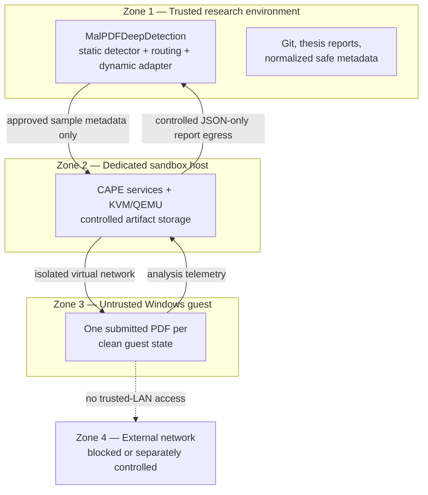

# Isolated CAPEv2 Laboratory Design

**Status:** design-only; no CAPE, hypervisor, guest, network, API, or sample has been installed, configured, started, or used. This document is an approval prerequisite for a future, separately authorized isolated-environment milestone.

## 1. Objective and project boundary

The proposed laboratory collects a small, controlled behavioural subset for thesis comparison with the established static detector. It supports the future flow below, while the current repository remains limited to offline parsing of already-produced JSON through `dynamic-schema-v1` (21 features).

The normal Windows development workstation is Zone 1 only. It must not host live malware or an analysis guest. The official thesis topology therefore uses two physical machines: Host A for development and Host B, a dedicated Linux sandbox host. A one-machine alternative has materially weaker separation—shared firmware, storage, peripherals, administrator trust, and recovery path—and is not suitable for an official malicious-sample experiment.

## 2. Official CAPEv2 baseline and revision policy

Official CAPEv2 guidance at the recorded documentation revision recommends Ubuntu 24.04 LTS, KVM, and Windows 10 or Windows 11 23H2 targets; it also distinguishes privileged rooter/installation work from normal services run as the dedicated `cape` user. CAPE is rolling rather than release-versioned, so this design does **not** define “latest CAPE” as reproducible. [Official README at recorded revision](https://github.com/kevoreilly/CAPEv2/blob/50e5dcd2de91cd36c2685037809fa102ccb0590a/README.md), [official host-installation guide](https://github.com/kevoreilly/CAPEv2/blob/50e5dcd2de91cd36c2685037809fa102ccb0590a/docs/book/src/installation/host/installation.rst).

Sources were retrieved on 2026-08-29 from official repository revision `50e5dcd2de91cd36c2685037809fa102ccb0590a` (commit date 2026-08-23). That revision is evidence for this design only; it is **not** the selected future installation revision. Before implementation, an approved reviewer must select an upstream commit for compatibility and safety—not benchmark performance—and record its full SHA, commit date, repository URL, any tag/signature evidence, hashes of reviewed installer files, and hash of the complete sanitized configuration snapshot. The selection remains fixed during an official experiment campaign.

## 3. Host and guest design

Host B is a dedicated Ubuntu 24.04 LTS system using KVM/QEMU with libvirt. A realistic thesis baseline is 8 physical CPU cores, 32 GiB RAM, and 1 TiB encrypted local storage; this is a budget for one Windows guest, CAPE processing, logs, and isolated retained artifacts, not a high-throughput farm. Allocate approximately 2 vCPU, 4 GiB RAM, and an 80 GiB virtual disk to the initial Windows 11 23H2 x64 guest. Increase resources only after harmless validation shows a documented need.

The guest has a local analysis-only account, no personal/cloud account, no personal browser profile, and no trusted documents. Its PDF application must be a dedicated analysis-only installation with a fixed, recorded version; automatic update/check-for-update behaviour is disabled or otherwise controlled for a recorded experimental snapshot, and any maintenance change creates a new guest configuration version. No vulnerable application is selected to recreate exploits. CAPE requires an agent in each guest according to official documentation; the future build records agent version and privilege requirements before snapshotting, but this design gives no installation procedure. Guest time zone and synchronization behaviour are recorded; Offline Mode does not depend on an Internet time service, and timestamps must be checked for a consistent host/guest relationship during harmless validation. [Official guest-agent document](https://github.com/kevoreilly/CAPEv2/blob/50e5dcd2de91cd36c2685037809fa102ccb0590a/docs/book/src/installation/guest/agent.rst).

## 4. Trust boundaries and network containment

Zone 1 contains source code, Git, thesis reports, static predictions, and normalized reports. Zone 2 contains CAPE, its hypervisor, firewalling, and controlled artifact storage. Zone 3 contains only the untrusted guest, submitted sample, spawned processes, and drops. Zone 4 is external connectivity, which is blocked by default or independently controlled after review.

The analysis guest never uses bridged networking to the normal LAN and must not reach the development machine, home/university LAN, NAS, router administration, private services, personal devices, SMB shares, or management interface. It communicates only with the dedicated host over a controlled virtual analysis network. Management and analysis networks are distinct. CAPEv2 documents routing configuration and host-port exposure as material controls; this design treats its examples as reference only, not commands to run. [Official routing guide](https://github.com/kevoreilly/CAPEv2/blob/50e5dcd2de91cd36c2685037809fa102ccb0590a/docs/book/src/installation/host/routing.rst), [official configuration guide](https://github.com/kevoreilly/CAPEv2/blob/50e5dcd2de91cd36c2685037809fa102ccb0590a/docs/book/src/installation/host/configuration.rst).

Two future modes are permitted in principle:

| Mode | Use | Required boundary |
| --- | --- | --- |
| A — Offline (default) | harmless validation, parser integration, and samples not needing network behaviour | no external Internet; only required host/guest analysis communications are allowed. |
| B — Controlled network observation | only after written approval where network evidence is scientifically needed | separate “dirty” egress or simulated services, firewall deny rules for all trusted destinations, event logging, and a fresh containment review. Unrestricted Internet is never enabled by this design. |

Host/guest writable folders, drive mappings, drag-and-drop, and shared clipboard are prohibited. There is no normal-LAN CAPE API exposure. Any future API must be explicitly approved, authenticated, host-firewall restricted, minimally bound, and never Internet exposed.

## 5. Sample ingress, report egress, and provenance

Future sample ingress is an explicit chain: authorized source → isolated quarantine/staging area → SHA-256 → research-safe `sample_id` → controlled CAPE submission → guest. Each sample record requires source, authorization status, acquisition date, cryptographic hash, label provenance, and ground-truth label where available. Original filenames are not trusted identifiers and are not unnecessarily exported. A static verdict is not ground truth.

Egress back to the research repository is JSON report plus required metadata only. `malpdf dynamic parse report.json` normalizes it without executing anything. Raw report checksums are retained for traceability, while raw reports remain outside Git when sensitive. Dropped files, executable bytes, memory dumps, PCAPs, full process dumps, and payloads remain in isolated artifact storage, never in this repository.

Each prospective dynamic-manifest row must include `sample_id`, `sample_sha256`, `sample_source`, `ground_truth_label`, `label_source`, static model/version/probability/verdict, routing policy/reason, sandbox platform, selected CAPE SHA, guest snapshot, guest OS, PDF application version, analysis timestamps/status, raw-report SHA-256, `dynamic-schema-v1`, and adapter-code SHA. Required provenance also includes configuration-snapshot and installer hashes. No real rows are created in this milestone.

## 6. Snapshot lifecycle and service/config inventory

The initial experiment is one sample per clean guest state: clean snapshot → one analysis → collect report → revert/destroy guest state → verify clean snapshot. The snapshot identifier and guest configuration version accompany every row. Contaminated state reuse is prohibited unless a separately approved persistence methodology says otherwise.

| Component | Purpose | Privilege / communication direction | Data handled | External exposure | Thesis requirement |
| --- | --- | --- | --- | --- | --- |
| `cape.service` | orchestrates analyses | dedicated `cape` user; host to guest | task metadata and analysis control | no normal-LAN/Internet exposure | required |
| `cape-processor.service` | processes telemetry/reports | dedicated `cape` user; host-local | guest telemetry and generated reports | host-local only | required |
| `cape-web.service` | optional local review interface | dedicated `cape` user; management boundary only | report presentation | disabled/not exposed initially | not required initially |
| `cape-rooter.service` | low-level routing control | privileged only as necessary; host network boundary | routing state, not research egress | no exposure to untrusted/trusted LAN services | required only for reviewed routing mode |
| KVM/libvirt | guest lifecycle and snapshot revert | restricted host administration | VM disk/snapshot state | host-local administration only | required |

Before any build, review the official configuration categories: `conf/cuckoo.conf`, `conf/auxiliary.conf`, selected machinery configuration such as `conf/kvm.conf`, `conf/memory.conf`, `conf/processing.conf`, `conf/reporting.conf`, `conf/routing.conf`, and any reviewed web/API configuration. The design does not generate credentials, addresses, or operational configuration. The official guide lists these categories and their role. [Official configuration reference](https://github.com/kevoreilly/CAPEv2/blob/50e5dcd2de91cd36c2685037809fa102ccb0590a/docs/book/src/installation/host/configuration.rst).

## 7. Storage, containment acceptance, and incident response

Plan isolated storage growth separately. Initial planning envelopes—not measured claims—are approximately 1–10 MiB per JSON report/log bundle, 10–100 MiB per screenshot/log bundle, and up to 0.5 GiB per sample for optional retained network metadata; raw forensic artifacts can exceed this and need a separate quota or retention decision. Retain only approved categories; raw samples and bulky artifacts do not enter Git or trusted sync folders. Back up reviewed host configuration and sanitized provenance separately from untrusted artifacts, then revise the envelope using harmless-validation measurements before approving a sample count.

**All controls below must pass before any authorized malicious sample.**

- [ ] Guest cannot access trusted LAN, development workstation, or private services.
- [ ] No host shares, clipboard, drag-and-drop, or drive mappings are available.
- [ ] Host firewall and management/analysis separation are verified.
- [ ] Network mode and any external egress policy are tested and logged.
- [ ] Guest snapshot/revert works and a clean state is independently verified.
- [ ] CAPE report collection/export works without executing report content on Host A.
- [ ] Test artifacts stay in isolated storage; no credential or personal account is present.
- [ ] The project parser accepts a benign synthetic report and preserves unavailable values.

If unexpected guest escape, LAN traffic, host executable arrival, unintended service exposure, persistence after revert, or abnormal traffic occurs: **stop analysis**, isolate the host/network as appropriate, preserve only necessary logs in controlled storage, do not continue a batch, and review containment before resuming. No malware-persistence or evasion procedure belongs in this project.

## 8. Future phases, validity, and approval gate

Future validation proceeds only with approval: harmless text/documents; synthetic benign PDFs; benign PDFs with harmless observable actions if ethically and safely constructed; then an authorized malicious subset only after containment review. The sample count is deliberately not fixed and must not be all 24,337 RIT rows. Future strata can include high-confidence static benign/malicious cases, uncertainty-region cases, static-unavailable cases, and authorized external labelled samples. RIT raw PDFs are not locally available, so this cannot yet be sampled from RIT.

Threats to validity include small/selected dynamic samples, sandbox visibility bias, application/version sensitivity, offline versus controlled-network behaviour differences, unavailable telemetry, and non-equivalence of static prediction, sandbox observation, and verified label. The future thesis contribution remains proportionate: a small, traceable behavioural dataset compared to static-only evidence, not a production sandbox or stealth/evasion effort.

**Approval gate:** implementation may begin only after a supervisor/reviewer approves the selected CAPE revision, Host B isolation, networking plan, guest/snapshot provenance, artifact-retention controls, and the containment checklist. This design does not authorize installation, guest creation, sample acquisition, API exposure, or execution.
